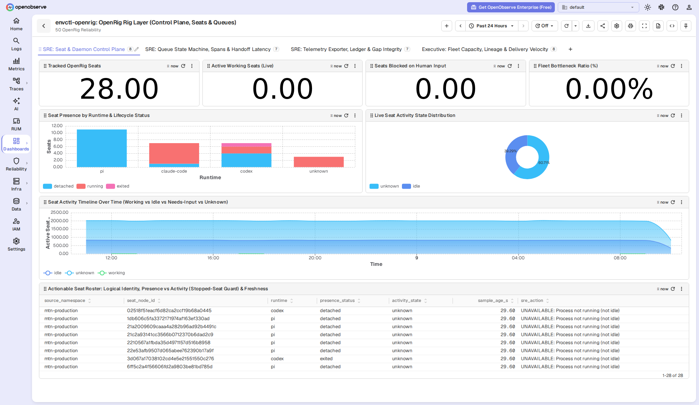
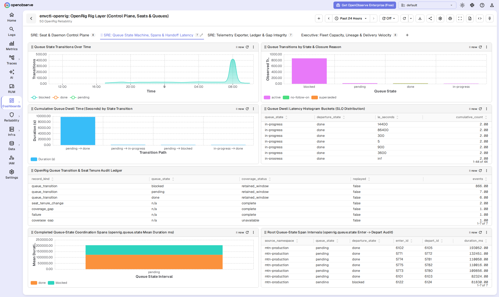
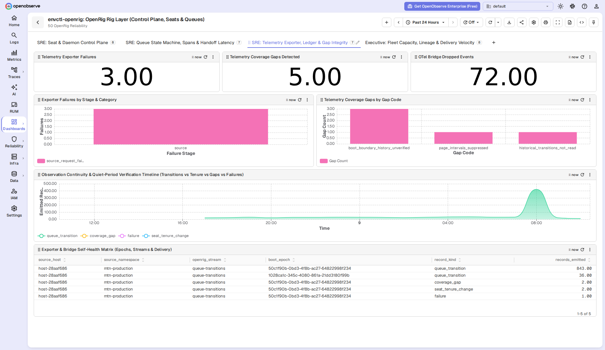
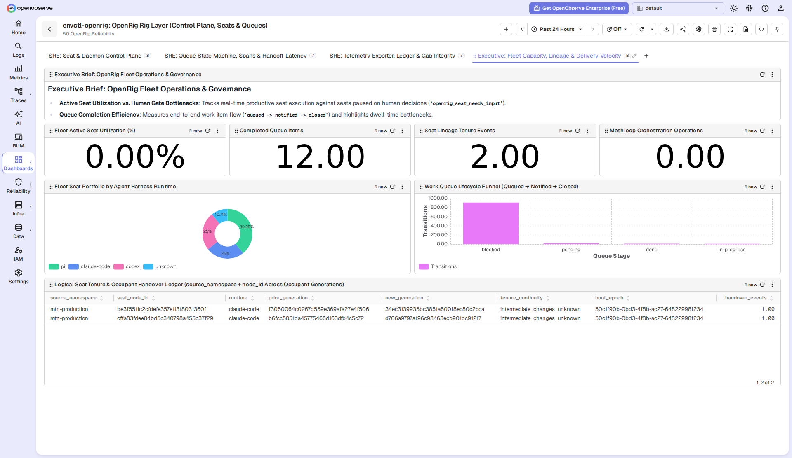
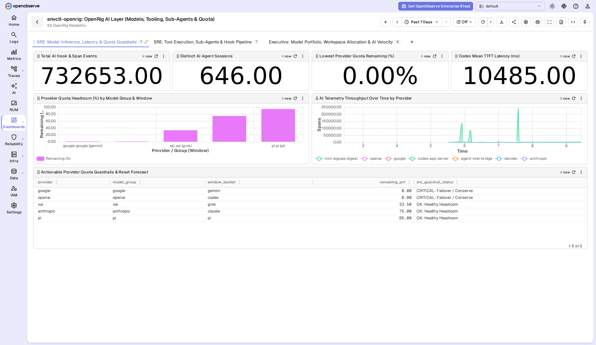
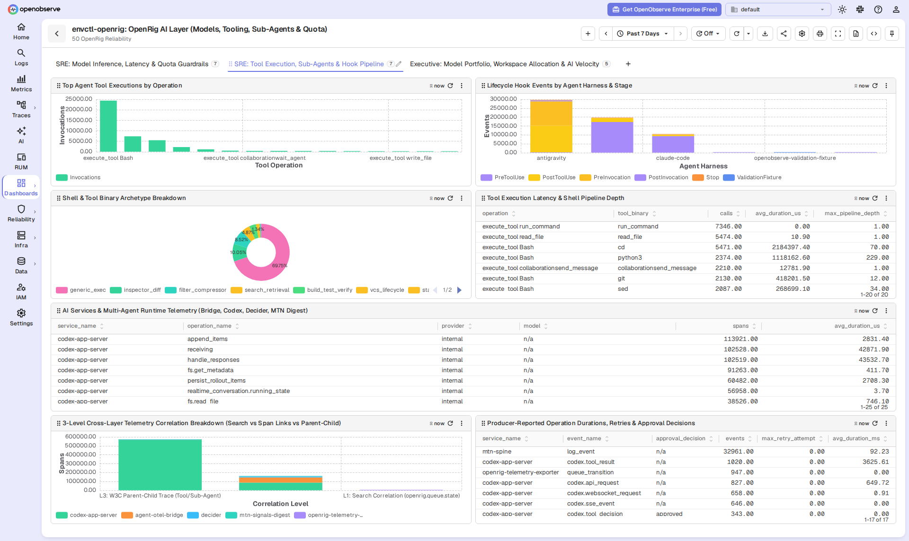
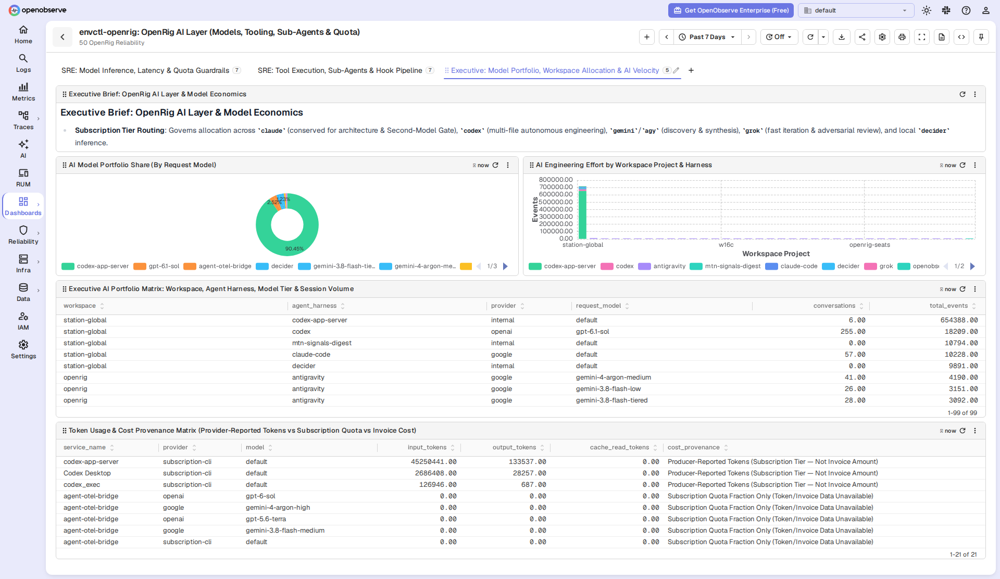
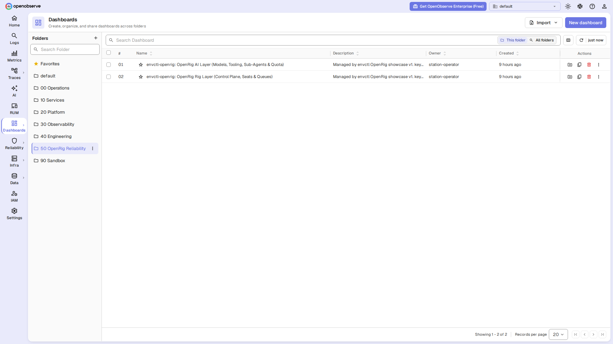
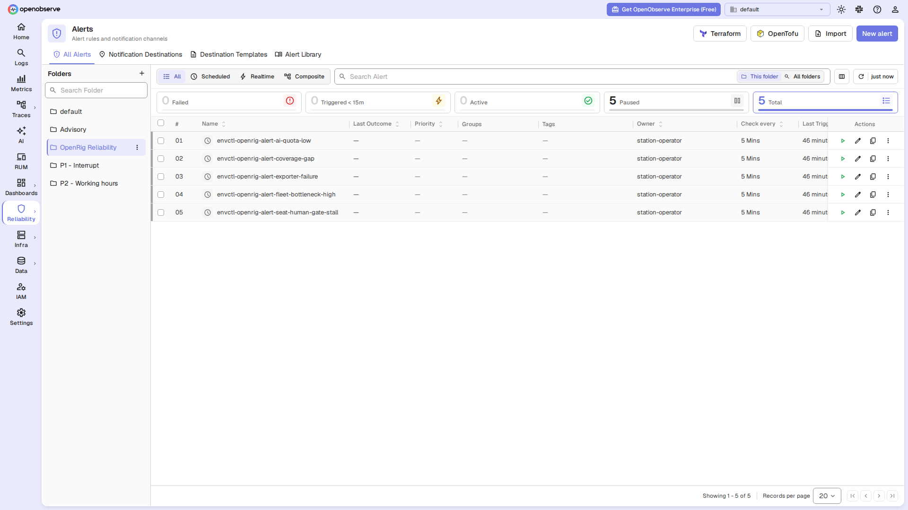

# OpenRig Observability Showcase & Reliability Suite (OpenObserve V8)

Production-ready observability dashboards and reliability alerts for [`openrig-telemetry`](../../README.md) (`telemetry-otlp.mjs`), designed around the architectural requirements of [`mvschwarz/openrig#2573`](https://github.com/mvschwarz/openrig/discussions/2573) and the finite telemetry contract of [`mvschwarz/openrig#2589`](https://github.com/mvschwarz/openrig/pull/2589).

---

## Contents of This Showcase Package

- **[`openrig_showcase.py`](./openrig_showcase.py)** — 100% standalone, zero-dependency Python 3 provisioning CLI (`plan`, `apply`, `validate-queries`, `export-json`, `rollback`) with atomic backups, rollback journals, and DataFusion SQL validation.
- **[`test_openrig_showcase.py`](./test_openrig_showcase.py)** — Offline `unittest` suite verifying V8 schema normalization, non-overlapping 192-column geometry, DataFusion SQL compatibility, and two-phase provisioning idempotence.
- **[`SPECIFICATION.md`](./SPECIFICATION.md)** — Full architectural and panel-by-panel technical specification with requirement traceability to Discussion #2573.
- **Portable V8 Dashboards & Alerts**:
  - [`dashboards/openrig-rig-layer.v8.json`](./dashboards/openrig-rig-layer.v8.json) — `envctl-openrig: OpenRig Rig Layer (Control Plane, Seats & Queues)` (`4` tabs, `30` panels)
  - [`dashboards/openrig-ai-layer.v8.json`](./dashboards/openrig-ai-layer.v8.json) — `envctl-openrig: OpenRig AI Layer (Models, Tooling, Sub-Agents & Quota)` (`3` tabs, `19` panels)
  - [`alerts/openrig-reliability-alerts.json`](./alerts/openrig-reliability-alerts.json) — `5` SQL scheduled reliability alerts in the `OpenRig Reliability` folder

---

## Quickstart

### Option A: Automated Two-Phase Provisioning & SQL Verification (`openrig_showcase.py`)

```sh
export OPENOBSERVE_URL="http://127.0.0.1:5080"
export OPENOBSERVE_ORG="default"
export ZO_ROOT_USER_EMAIL="operator@example.com"
export ZO_ROOT_USER_PASSWORD="your-password"

BACKUP_DIR="$HOME/.local/state/openrig-telemetry/showcase-backup"

# 1. Provision the '50 OpenRig Reliability' (dashboards) and 'OpenRig Reliability' (alerts) folders
python3 examples/openobserve-showcase/openrig_showcase.py apply --phase folders --backup-dir "$BACKUP_DIR"

# 2. Provision the 2 multi-tab V8 Showcase Dashboards and 5 SQL Reliability Alerts
python3 examples/openobserve-showcase/openrig_showcase.py apply --phase catalog --backup-dir "$BACKUP_DIR"

# 3. Validate all 52 SQL queries (47 dashboard SQL panels + 5 alert queries) against live DataFusion
python3 examples/openobserve-showcase/openrig_showcase.py validate-queries --output "$BACKUP_DIR/query-validation.json"

# 4. Verify idempotence (0 pending mutations)
python3 examples/openobserve-showcase/openrig_showcase.py plan --phase catalog --backup-dir "$BACKUP_DIR"
```

### Option B: Direct JSON Import in OpenObserve UI

1. In OpenObserve, create or open the `50 OpenRig Reliability` dashboard folder and import:
   - [`dashboards/openrig-rig-layer.v8.json`](./dashboards/openrig-rig-layer.v8.json)
   - [`dashboards/openrig-ai-layer.v8.json`](./dashboards/openrig-ai-layer.v8.json)
2. To regenerate the portable JSON files after customizing `openrig_showcase.py`:
   ```sh
   python3 examples/openobserve-showcase/openrig_showcase.py export-json --output-dir examples/openobserve-showcase
   ```

---

## Visual Walkthrough

### 1. Dashboard 1: `envctl-openrig: OpenRig Rig Layer (Control Plane, Seats & Queues)`

Bridges **SRE Control-Plane Operations** and **Executive Fleet Governance** over the `logs`, `metrics`, and `traces` emitted by `telemetry-otlp.mjs`.

#### Tab 1 (`sre-control`): `SRE: Seat & Daemon Control Plane`
- Tracks live seat counts, working seats, human-gate stalls (`openrig_seat_needs_input`), and fleet bottleneck ratio.
- Separates process presence (`running`, `detached`, `exited`, `stopped`) from seat activity (`working`, `idle`, `needs-input`, `unknown`) so **stopped processes are never misclassified as idle capacity**.
- Includes the **Seat Activity Timeline Over Time** and the **Actionable Seat Roster** with a 5-minute freshness/staleness guard (`sample_age_s`).



#### Tab 2 (`sre-queues`): `SRE: Queue State Machine, Spans & Handoff Latency`
- Visualizes queue transition velocity, closure reasons (`active`, `no-follow-on`, `superseded`), cumulative dwell time (`openrig_queue_state_duration_sum`), and SLO latency histogram buckets (`openrig_queue_state_duration_bucket`).
- Inspects completed **`openrig.queue.state` root coordination spans** (`traces/default`) with exact entry and departure transition IDs (`openrig_transition_enter_id` → `openrig_transition_depart_id`).



#### Tab 3 (`sre-exporter`): `SRE: Telemetry Exporter, Ledger & Gap Integrity`
- Tracks `openrig-telemetry-exporter` stage/category failures (`openrig_telemetry_failure`), sequence/window coverage gaps (`openrig_telemetry_coverage_gap`), and OTel bridge drop counters.
- Provides the **Observation Continuity & Quiet-Period Verification Timeline** so operators can immediately tell whether an apparent quiet period is real or caused by missing observation or a daemon `bootEpoch` reset.



#### Tab 4 (`exec-rig`): `Executive: Fleet Capacity, Lineage & Delivery Velocity`
- Provides an executive brief, active seat utilization percentage, completed queue item throughput, runtime portfolio share, and work queue lifecycle funnel.
- Tracks **Logical Seat Identity (`source_namespace + immutable nodeId`)** across occupant tenure handovers (`seat_tenure_change`: `prior_generation` → `new_generation`) and distinguishes durable `source_namespace` identity from transient daemon `bootEpoch` values.



---

### 2. Dashboard 2: `envctl-openrig: OpenRig AI Layer (Models, Tooling, Sub-Agents & Quota)`

Complements `openrig-telemetry` coordination signals with native agent runtime telemetry (`Claude Code`, `Codex`, `Antigravity`/`Gemini`, `Grok`, local `decider`) and hot-path lifecycle hooks (`agent-otel-bridge`).

#### Tab 1 (`sre-inference`): `SRE: Model Inference, Latency & Quota Guardrails`
- Monitors total AI hook/span events, distinct agent sessions, Codex TTFT latency, and per-provider subscription quota headroom (`agent_quota_remaining_fraction`) with automated failover/conservation guardrails.



#### Tab 2 (`sre-tools`): `SRE: Tool Execution, Sub-Agents & Hook Pipeline`
- Audits top tool invocations (`execute_tool *`), lifecycle hook stages (`PreToolUse`, `PostToolUse`), shell binary archetypes, and multi-agent sub-agent spawns (`invoke_agent *`).
- Classifies telemetry across the **3 Correlation Levels** defined in Discussion #2573 (`L1: Search Correlation`, `L2: OTel Span Links`, `L3: W3C Parent-Child Traces`) alongside producer-reported operation durations, retries, and approval waits.



#### Tab 3 (`exec-ai`): `Executive: Model Portfolio, Workspace Allocation & AI Velocity`
- Tracks model portfolio share, engineering effort by workspace project and harness, and the **Token Usage & Cost Provenance Matrix**—strictly separating **Producer-Reported Tokens (Subscription Tier — Not Invoice Amount)** from **Subscription Quota Fractions** and **Estimated/Invoice Costs**.



---

### 3. Dedicated `OpenRig Reliability` Folders & Actionable SQL Alerts

All showcase dashboards live in the **`50 OpenRig Reliability`** dashboard folder, and all 5 SQL scheduled reliability alerts live in the **`OpenRig Reliability`** alert folder:




